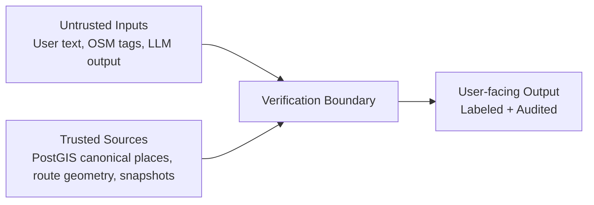

# TrailForge Architecture

This document is the root architecture summary. Detailed design lives in [`docs/architecture/ARCHITECTURE.md`](docs/architecture/ARCHITECTURE.md).

## System Goal

Convert natural-language travel intent into **verified, real-world itineraries**. The system is designed so that no location claim reaches users as verified unless it is traceable to geographic source data.

## Architectural Style

- **Microservices** for independently scalable domains (discovery, routing, AI orchestration, verification, export).
- **Domain-driven design** with explicit bounded contexts and ownership.
- **Event-driven integration** for async workflows, audit propagation, and decoupling.
- **Deterministic geospatial core** in PostgreSQL/PostGIS; AI is a narrator, not source of truth.

## Core Services

| Service | Responsibility |
|---|---|
| API Gateway / BFF | Auth, rate limiting, request shaping, aggregation |
| Itinerary Service | Orchestrates end-to-end generation lifecycle |
| Geospatial Service | OSM/Overpass ingestion, canonical place resolution, spatial search |
| Routing Service | Deterministic route optimization and travel-time computation |
| AI Orchestrator | Prompt templates, model routing (GPT/Claude/Gemini), grounded generation |
| Verification Engine | Claim extraction, fact matching, confidence scoring, status labeling |
| Content/Export Service | Multilingual content packaging, PDF/GeoJSON/GPX/KML/ICS exports |
| Audit/Compliance Service | Immutable audit trail, provenance records, compliance events |

## End-to-End Flow

1. User submits natural-language request.
2. Geospatial service resolves area and discovers candidate places from canonical sources.
3. Routing service computes feasible route under constraints.
4. AI orchestrator generates grounded narrative/translation from source facts.
5. Verification engine extracts claims, matches evidence, assigns confidence and status.
6. Itinerary service persists versioned output + audit trail.
7. API returns itinerary with verification summary and provenance.

## Trust Boundary

## Technology Decisions

- **Next.js + TypeScript + Tailwind + MapLibre GL + React Query** for a high-quality, map-centric web UX.
- **NestJS + Node.js + TypeScript** for modular, testable backend services.
- **PostgreSQL + PostGIS + Redis** for spatial truth, caching, and performance.
- **Multi-model AI abstraction** over GPT/Claude/Gemini with task-based routing.
- **AWS + Docker + Terraform + GitHub Actions** for reproducible infrastructure and delivery.
- **OpenTelemetry + Prometheus + Grafana** for observability.

## Detailed Docs

- [System Architecture](docs/architecture/ARCHITECTURE.md)
- [Data Model](docs/architecture/DATA_MODEL.md)
- [API Spec](docs/architecture/API_SPEC.md)
- [Security Plan](docs/architecture/SECURITY_PLAN.md)
