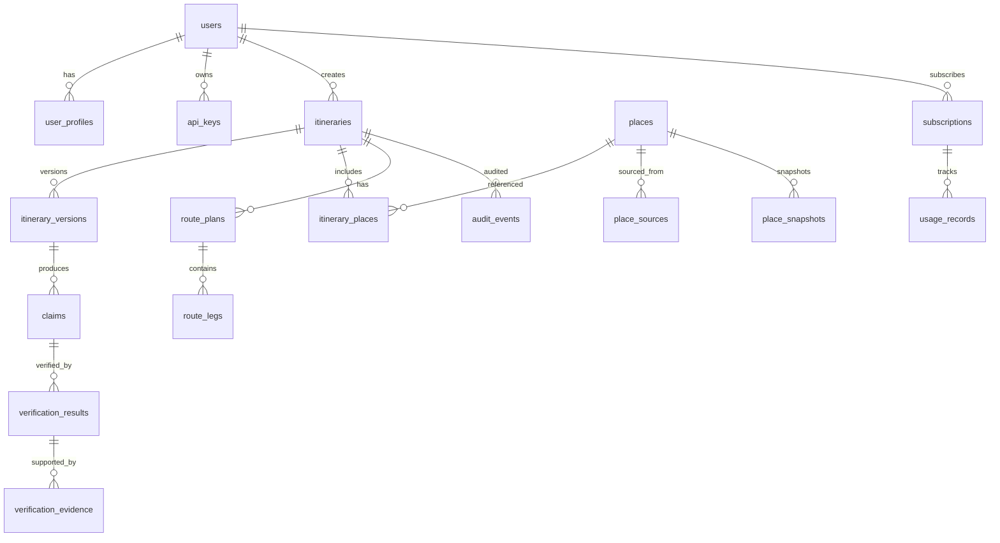

# Data Model — TrailForge

## 1. Data Architecture Principles

- **PostgreSQL + PostGIS is the system of record** for transactional and spatial data.
- **Every geographic entity has provenance.** `source_type`, `source_id`, `source_snapshot_id`, `observed_at`.
- **AI outputs are versioned and auditable.** Never overwrite generated content in place; create new versions.
- **PII is isolated and minimizable.** Profile/billing data separated from itinerary content; encryption and retention policies applied.
- **Idempotency and event dedupe are first-class.** Outbox/inbox tables support reliable async processing.

## 2. Logical Domains

## 3. Core Tables

### 3.1 Identity & Access

#### `users`
| Column | Type | Constraints | Notes |
|---|---|---|---|
| id | uuid | PK | `gen_random_uuid()` |
| email | citext | UNIQUE, NOT NULL | normalized |
| email_verified_at | timestamptz | NULL |  |
| auth_provider | text | NOT NULL | `password`, `google`, `github`, `saml` |
| status | text | NOT NULL | `active`, `suspended`, `deleted` |
| created_at | timestamptz | NOT NULL |  |
| updated_at | timestamptz | NOT NULL |  |

#### `user_profiles`
| Column | Type | Constraints | Notes |
|---|---|---|---|
| user_id | uuid | PK, FK users.id |  |
| display_name | text |  |  |
| locale | text | NOT NULL default 'en' | BCP-47 |
| timezone | text | NOT NULL default 'UTC' | IANA |
| preferences | jsonb | NOT NULL default '{}' | travel pace, accessibility, themes |
| created_at | timestamptz | NOT NULL |  |
| updated_at | timestamptz | NOT NULL |  |

#### `api_keys`
| Column | Type | Constraints | Notes |
|---|---|---|---|
| id | uuid | PK |  |
| user_id | uuid | FK users.id, NOT NULL |  |
| name | text | NOT NULL |  |
| key_hash | bytea | NOT NULL, UNIQUE | SHA-256/Argon2 hash; never store raw key |
| scopes | text[] | NOT NULL |  |
| last_used_at | timestamptz |  |  |
| expires_at | timestamptz |  |  |
| revoked_at | timestamptz |  |  |

### 3.2 Geospatial / Places

#### `places`
| Column | Type | Constraints | Notes |
|---|---|---|---|
| id | uuid | PK | canonical internal ID |
| canonical_source | text | NOT NULL | `osm`, `licensed_poi`, `gov_open_data` |
| canonical_source_id | text | NOT NULL | e.g. `osm:node:123` |
| name | text | NOT NULL | primary display name |
| name_local | text |  | local language name |
| category | text | NOT NULL | normalized taxonomy |
| tags | jsonb | NOT NULL default '{}' | source tags |
| location | geography(Point,4326) | NOT NULL |  |
| geometry | geometry(Geometry,4326) |  | polygon/line if applicable |
| address | jsonb |  | structured address |
| opening_hours | jsonb |  | normalized |
| confidence | numeric(4,3) | NOT NULL | source confidence 0-1 |
| provenance | jsonb | NOT NULL | source metadata |
| first_seen_at | timestamptz | NOT NULL |  |
| last_verified_at | timestamptz | NOT NULL |  |
| created_at | timestamptz | NOT NULL |  |
| updated_at | timestamptz | NOT NULL |  |

**Indexes:**
- `UNIQUE (canonical_source, canonical_source_id)`
- `GIST (location)`
- `GIST (geometry)`
- `GIN (tags jsonb_path_ops)`
- `BTREE (category)`
- Full-text index on `name`, `name_local`

#### `place_sources`
| Column | Type | Constraints | Notes |
|---|---|---|---|
| id | uuid | PK |  |
| place_id | uuid | FK places.id |  |
| source_type | text | NOT NULL | `osm`, `overpass`, `nominatim`, etc. |
| source_id | text | NOT NULL |  |
| source_url | text |  |  |
| license | text |  | e.g. ODbL |
| raw_payload | jsonb |  | optional, size-controlled |
| fetched_at | timestamptz | NOT NULL |  |

#### `place_snapshots`
| Column | Type | Constraints | Notes |
|---|---|---|---|
| id | uuid | PK |  |
| place_id | uuid | FK places.id |  |
| snapshot_hash | text | NOT NULL | hash of normalized fact set |
| facts | jsonb | NOT NULL | canonical fact representation used for verification |
| valid_from | timestamptz | NOT NULL |  |
| valid_to | timestamptz |  |  |

### 3.3 Itineraries & Routes

#### `itineraries`
| Column | Type | Constraints | Notes |
|---|---|---|---|
| id | uuid | PK |  |
| user_id | uuid | FK users.id, NULL for anon/enterprise |  |
| status | text | NOT NULL | `pending`, `generating`, `verified`, `partial`, `needs_review`, `failed` |
| request_text | text | NOT NULL | original NL request |
| request_locale | text | NOT NULL |  |
| constraints | jsonb | NOT NULL default '{}' | duration, theme, accessibility, crowd avoidance |
| area | geography(Polygon,4326) |  | resolved area of interest |
| center | geography(Point,4326) |  |  |
| created_at | timestamptz | NOT NULL |  |
| updated_at | timestamptz | NOT NULL |  |

#### `itinerary_versions`
| Column | Type | Constraints | Notes |
|---|---|---|---|
| id | uuid | PK |  |
| itinerary_id | uuid | FK itineraries.id |  |
| version | int | NOT NULL | monotonic |
| status | text | NOT NULL | verification status |
| title | text |  |  |
| summary | text |  |  |
| language | text | NOT NULL |  |
| content | jsonb | NOT NULL | structured itinerary content blocks |
| model_run_ids | uuid[] |  |  |
| verification_summary | jsonb | NOT NULL | counts, overall confidence |
| created_at | timestamptz | NOT NULL |  |

**Unique:** `(itinerary_id, version)`

#### `itinerary_places`
| Column | Type | Constraints | Notes |
|---|---|---|---|
| itinerary_version_id | uuid | FK itinerary_versions.id |  |
| place_id | uuid | FK places.id |  |
| sequence_order | int | NOT NULL |  |
| stay_minutes | int |  |  |
| role | text |  | `stop`, `waypoint`, `highlight` |
| PRIMARY KEY | | (itinerary_version_id, place_id, sequence_order) |  |

#### `route_plans`
| Column | Type | Constraints | Notes |
|---|---|---|---|
| id | uuid | PK |  |
| itinerary_version_id | uuid | FK itinerary_versions.id |  |
| mode | text | NOT NULL | `walk`, `transit`, `bike`, `mixed` |
| geometry | geometry(LineString,4326) | NOT NULL | deterministic route |
| distance_meters | int | NOT NULL |  |
| duration_minutes | int | NOT NULL |  |
| optimization_meta | jsonb | NOT NULL | algorithm, constraints, cost |
| created_at | timestamptz | NOT NULL |  |

#### `route_legs`
| Column | Type | Constraints | Notes |
|---|---|---|---|
| id | uuid | PK |  |
| route_plan_id | uuid | FK route_plans.id |  |
| leg_order | int | NOT NULL |  |
| from_place_id | uuid | FK places.id |  |
| to_place_id | uuid | FK places.id |  |
| geometry | geometry(LineString,4326) | NOT NULL |  |
| distance_meters | int | NOT NULL |  |
| duration_minutes | int | NOT NULL |  |
| instructions | jsonb |  | optional turn-by-turn |

### 3.4 AI & Verification

#### `model_runs`
| Column | Type | Constraints | Notes |
|---|---|---|---|
| id | uuid | PK |  |
| itinerary_id | uuid | FK itineraries.id |  |
| provider | text | NOT NULL | `openai`, `anthropic`, `google` |
| model | text | NOT NULL |  |
| purpose | text | NOT NULL | `extract`, `narrate`, `translate`, `summarize` |
| prompt_version | text | NOT NULL |  |
| input_hash | text | NOT NULL |  |
| output_hash | text | NOT NULL |  |
| token_usage | jsonb |  |  |
| latency_ms | int |  |  |
| created_at | timestamptz | NOT NULL |  |

#### `claims`
| Column | Type | Constraints | Notes |
|---|---|---|---|
| id | uuid | PK |  |
| itinerary_version_id | uuid | FK itinerary_versions.id |  |
| place_id | uuid | FK places.id, NULL |  |
| claim_type | text | NOT NULL | `existence`, `attribute`, `location`, `hours`, `description` |
| text | text | NOT NULL | normalized claim text |
| source_span | jsonb |  | location in generated content |
| extracted_by | text | NOT NULL | `rule`, `llm`, `hybrid` |
| created_at | timestamptz | NOT NULL |  |

#### `verification_results`
| Column | Type | Constraints | Notes |
|---|---|---|---|
| id | uuid | PK |  |
| claim_id | uuid | FK claims.id, UNIQUE | one current result per claim version |
| status | text | NOT NULL | `VERIFIED`, `PARTIALLY_VERIFIED`, `NEEDS_REVIEW` |
| confidence | numeric(4,3) | NOT NULL | 0-1 |
| reason | text |  |  |
| matcher | text | NOT NULL | rule/semantic/hybrid |
| verified_at | timestamptz | NOT NULL |  |

#### `verification_evidence`
| Column | Type | Constraints | Notes |
|---|---|---|---|
| id | uuid | PK |  |
| verification_result_id | uuid | FK verification_results.id |  |
| source_type | text | NOT NULL |  |
| source_id | text | NOT NULL |  |
| fact_path | text |  | JSON path / field |
| expected | jsonb |  |  |
| observed | jsonb |  |  |
| weight | numeric(4,3) |  |  |

### 3.5 Audit / Billing / Ops

#### `audit_events`
| Column | Type | Constraints | Notes |
|---|---|---|---|
| id | uuid | PK |  |
| actor_type | text | NOT NULL | `user`, `service`, `system` |
| actor_id | text |  |  |
| action | text | NOT NULL |  |
| entity_type | text | NOT NULL |  |
| entity_id | uuid |  |  |
| correlation_id | uuid |  |  |
| payload | jsonb | NOT NULL | redacted/safe |
| created_at | timestamptz | NOT NULL | immutable |

#### `subscriptions`, `usage_records`, `event_outbox`, `event_inbox`
- Standard SaaS billing/metering tables.
- Outbox/inbox for reliable event delivery and idempotent consumption.

## 4. PostGIS Usage

Key spatial capabilities used:

- `ST_DWithin(location, :point, :radius)` for radius discovery.
- `ST_Intersects` / `ST_Within` for area constraints.
- `ST_Distance` for proximity scoring.
- `ST_MakeLine` / `ST_LineMerge` for route geometry.
- `GIST` indexes on geography/geometry columns.
- Materialized views for hot city/area discovery tiles.

## 5. Data Retention & Privacy

| Data Class | Retention | Notes |
|---|---|---|
| User account PII | Until deletion + legal hold | GDPR erasure supported |
| Itinerary content | User-controlled; default 24 months inactive | Anonymizable for analytics |
| Audit events | 7 years (enterprise) / 2 years (B2C) | Immutable WORM storage option |
| Raw LLM prompts/outputs | 30 days default | Redacted; configurable for enterprise |
| Place snapshots | Indefinite (versioned) | Required for verification reproducibility |

## 6. Migrations & Schema Governance

- Migrations via Prisma Migrate or TypeORM migrations in infra-owned pipeline; reviewed in PR.
- Backward-compatible migration policy: expand → migrate → contract.
- Spatial indexes created concurrently where possible.
- All schema changes require data classification review.
