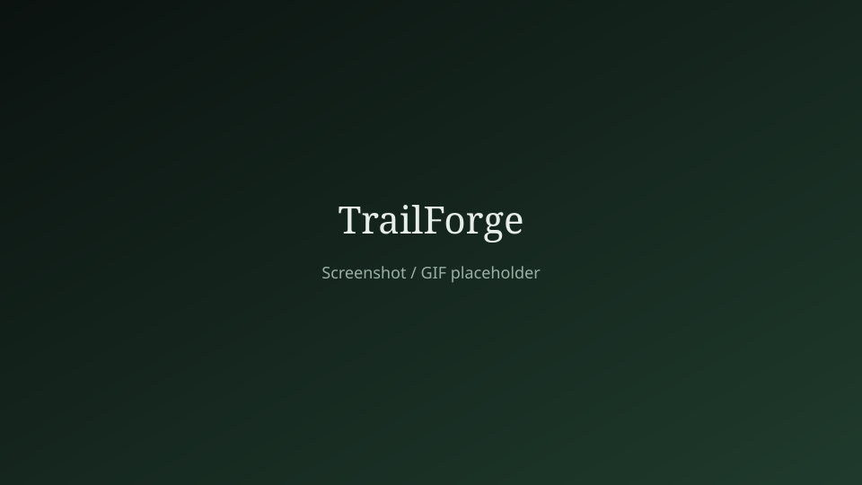
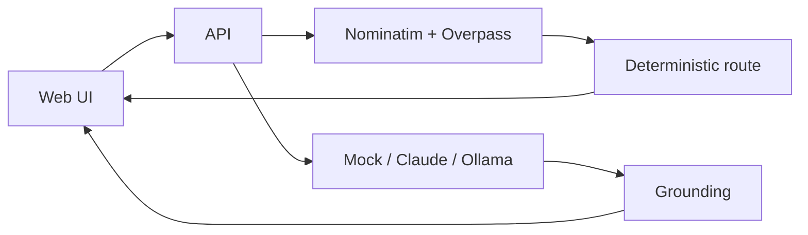

# TrailForge

TrailForge turns an area + theme + duration into a grounded walking tour: real OpenStreetMap places, a dusk 3D city preview, and Japanese/English blurbs that may only cite OSM tags. Claims are verified in code before they reach export.



## Quick start

```bash
npm ci
cp apps/api/.env.example apps/api/.env
npm run dev
```

Open http://localhost:5173 — Vite proxies `/api` to the API on port 3001.

## Architecture



See [docs/ARCHITECTURE.md](docs/ARCHITECTURE.md) for the threat model and grounding rules.

## Workspaces

| Path              | Role                     |
| ----------------- | ------------------------ |
| `apps/web`        | Vite + React + R3F       |
| `apps/api`        | Express generate API     |
| `packages/shared` | Zod schemas + projection |

## Scripts

```bash
npm run typecheck
npm run lint
npm test
npm run build
npm run eval          # MockProvider fixture eval → docs/EVAL.md
```

## Env

See `apps/api/.env.example`. LLM keys never go to the browser. Default `LLM_PROVIDER=mock`.

## Data & licenses

Map data © OpenStreetMap contributors (ODbL). See `NOTICE`. App code is MIT (`LICENSE`).

## Limitations (honest)

- Nominatim/Overpass may rate-limit or block some cloud IPs; demos fall back to fixtures.
- Mock LLM is deterministic for CI; Claude/Ollama need keys/hosts and are stubs for production-quality prose until configured.
- 3D scene uses merged meshes but is not a full city twin; building caps apply.
- Lighthouse is documented for manual verification; not gated in CI yet.

## Roadmap

Smarter theme→tag maps, live Overpass in demos, richer review UX, hosted demo URL.

## Deploy

[docs/DEPLOY.md](docs/DEPLOY.md) · Docker: `docker compose up --build api`
