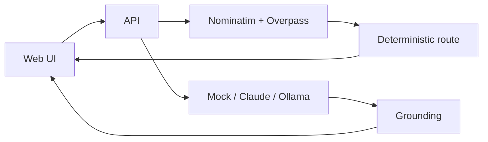

# TrailForge

TrailForge turns an area + theme + duration into a grounded walking tour: real OpenStreetMap places, a dusk 3D city preview, and Japanese/English blurbs that may only cite OSM tags. Claims are verified in code before they reach export.

© OpenStreetMap contributors (ODbL). App code is MIT (`LICENSE`).

## Launch (local)

```bash
npm ci
cp apps/api/.env.example apps/api/.env
# optional UI flags: cp apps/web/.env.example apps/web/.env
npm run dev
```

| Surface    | URL                                              |
| ---------- | ------------------------------------------------ |
| Web (Vite) | http://localhost:5173                            |
| API        | http://localhost:3001 (`/api` proxied from Vite) |
| Health     | http://localhost:3001/api/health                 |
| Ready      | http://localhost:3001/api/ready                  |

Default `LLM_PROVIDER=mock` — no Anthropic key required for CI or first run.

### Production / Cursor publish (single process)

Vite-only publish cannot see server secrets such as `GOOGLE_MAPS_API_KEY`. Run the API as the process that also serves the built web UI:

```bash
npm ci
cp apps/api/.env.example apps/api/.env   # set GOOGLE_MAPS_API_KEY server-side only
npm start                                # builds web → serves apps/web/dist from API
```

| Surface                 | URL                              |
| ----------------------- | -------------------------------- |
| App + API (same origin) | http://localhost:3001            |
| Health                  | http://localhost:3001/api/health |

`npm start` builds `@trailforge/web`, then starts the API with `NODE_ENV=production` on `PORT` (default **3001**). In production the API serves `apps/web/dist` (override path with `WEB_DIST_PATH`; force with `SERVE_WEB=true` / disable with `SERVE_WEB=false`). Same-origin browser calls do not need a separate Vite proxy; set `CORS_ORIGIN` to the public app URL when the SPA is hosted elsewhere.

### Demo / fixtures (always labeled)

- UI: `http://localhost:5173/app?demo=1` or `VITE_DEMO_MODE=true` → **DEMO DATA** badge
- API: `LOCAL_DEV_DATA_SOURCE=true` → **DEV MODE** fixtures (not live OSM)

Never silent SAMPLE cities on the production path.

## Architecture



See [docs/ARCHITECTURE.md](docs/ARCHITECTURE.md) and [docs/SECURITY.md](docs/SECURITY.md).

## Workspaces

| Path              | Role                     |
| ----------------- | ------------------------ |
| `apps/web`        | Vite + React + R3F       |
| `apps/api`        | Express generate API     |
| `packages/shared` | Zod schemas + projection |

## Scripts

```bash
npm run typecheck
npm run lint
npm test
npm run build
npm start             # build web + serve from API (PORT=3001)
npm run eval          # MockProvider → docs/EVAL.md
npm run test:e2e      # optional Playwright smoke (install chromium first)
```

## Env

| File                    | Purpose                                       |
| ----------------------- | --------------------------------------------- |
| `apps/api/.env.example` | API secrets + LLM + routing + optional DB/JWT |
| `apps/web/.env.example` | Publishable `VITE_*` only                     |
| `.env.example`          | Root mirror of API vars for operators         |

LLM and ORS/GraphHopper keys stay server-side. If `DATABASE_URL` is set, boot requires `JWT_SECRET` (≥16 chars).

## Docs

| Doc                                                      | Purpose                                        |
| -------------------------------------------------------- | ---------------------------------------------- |
| [docs/ENGINEERING_REPORT.md](docs/ENGINEERING_REPORT.md) | Final reconstruction report + honest scorecard |
| [docs/ARCHITECTURE.md](docs/ARCHITECTURE.md)             | Data flow, grounding, threat model             |
| [docs/PHASES.md](docs/PHASES.md)                         | What each phase shipped                        |
| [docs/SPATIAL.md](docs/SPATIAL.md)                       | Coverage adapters (extrusions default)         |
| [docs/ENVIRONMENT.md](docs/ENVIRONMENT.md)               | Solar + weather honesty                        |
| [docs/ROUTING.md](docs/ROUTING.md)                       | Multi-objective route + pedestrian meters      |
| [docs/PERFORMANCE.md](docs/PERFORMANCE.md)               | 3D / a11y budgets                              |
| [docs/SECURITY.md](docs/SECURITY.md)                     | Keys, CORS, rate limits                        |
| [docs/DEPLOY.md](docs/DEPLOY.md)                         | Deploy checklist                               |
| [docs/EVAL.md](docs/EVAL.md)                             | Mock eval output                               |

## Limitations (honest)

- **Not a city twin.** 3D is merged OSM footprint extrusions (≤ ~2k buildings budget), not Google/Cesium photoreal. MapTiler/Cesium keys alone do not enable tiles — adapters are coverage-aware and fall back to extrusions (`docs/SPATIAL.md`).
- **OSM egress.** Nominatim/Overpass may rate-limit or block some cloud IPs; use labeled DEMO / LOCAL_DEV — never invent places.
- **LLM.** Default Mock is for CI/determinism; Claude/Ollama need keys/hosts. Grounding still rejects uncited claims.
- **Weather.** Off until `VITE_WEATHER_PROVIDER=openmeteo`; failures stay “unavailable,” never fake rain.
- **Pedestrian distance.** ORS/GraphHopper when keyed; otherwise labeled euclidean×1.3.
- **Auth / save.** Optional Postgres; without DB, generate still works; save requires sign-in.
- **Deploy URL.** No production demo URL is claimed in this repo — see placeholder in `docs/DEPLOY.md`.

## Deploy

[docs/DEPLOY.md](docs/DEPLOY.md) · `docker compose up --build api`
