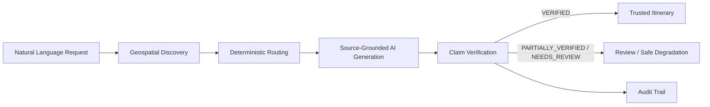

# TrailForge

**Trusted AI-powered geospatial intelligence for verified real-world experiences.**

TrailForge converts natural-language travel requests into verified, source-grounded itineraries. Users ask for things like *"2-hour cultural walk in Asakusa"* or *"Anime day trip in Akihabara"*, and TrailForge discovers real places, computes realistic routes, generates multilingual content, and verifies every claim against geographic source data before presenting it.

> **Core principle: Never hallucinate locations.** Every place, route, description, and recommendation must be traceable to real-world source data.

---

## Why TrailForge

Generic AI can describe a trip beautifully and still invent a place that does not exist. Traditional map tools are accurate but cannot turn intent into a coherent experience. TrailForge is the **trust layer between generative AI and geographic knowledge**.

| Capability | What it means |
|---|---|
| **Grounded discovery** | Places resolve to canonical source records (OSM/Overpass, geocoding, licensed data) |
| **Deterministic routing** | Routes are computed by spatial algorithms, not guessed by an LLM |
| **Source-grounded AI** | Narratives/translations are generated from retrieved facts with citations |
| **Claim verification** | Every claim is scored and labeled `VERIFIED`, `PARTIALLY_VERIFIED`, or `NEEDS_REVIEW` |
| **Audit trails** | Every itinerary carries provenance and verification evidence |

---

## Product Scope

This repository contains the TrailForge production blueprint, architecture, documentation, and implementation scaffold:

- **Product strategy**: vision, business model, personas, value proposition, metrics, competitive analysis
- **System architecture**: microservices, DDD bounded contexts, event-driven design, data flow, AWS deployment
- **Data model**: PostgreSQL + PostGIS schema, provenance, verification/audit tables
- **API specification**: REST/OpenAPI-oriented contract for itinerary generation, places, routing, verification, exports
- **Security plan**: IAM, threat model, GDPR controls, audit logging, AI safety gates
- **Implementation scaffold**: TypeScript monorepo structure for web, API/services, shared domain packages, infra, CI/CD

---

## Repository Structure

```text
.
├── apps/
│   ├── api/                    # Existing API workspace (legacy prototype) + evolving service code
│   └── web/                    # Existing web workspace (legacy prototype)
├── packages/
│   ├── shared/                 # Shared schemas/types (legacy)
│   ├── domain/                 # Domain models, value objects, verification primitives
│   ├── config/                 # Shared TS/ESLint/build config
│   └── ai-core/                # AI provider abstraction and prompt contracts
├── services/                   # Production service scaffolds (NestJS-oriented)
│   ├── itinerary-service/
│   ├── geospatial-service/
│   ├── routing-service/
│   ├── ai-orchestrator/
│   └── verification-service/
├── infra/
│   ├── terraform/              # AWS IaC modules and environments
│   └── docker/                 # Dockerfiles and local compose overlays
├── docs/
│   ├── strategy/               # Product strategy docs
│   ├── architecture/           # Architecture, data model, API spec, security plan
│   ├── ops/                    # Deployment/runbooks
│   └── ...                     # Existing prototype docs
├── .github/workflows/          # CI/CD pipelines
├── ARCHITECTURE.md             # Root architecture summary (links to detailed docs)
├── ROADMAP.md                  # Delivery roadmap
├── DATABASE.md                 # Database/PostGIS overview
├── SECURITY.md                 # Security overview
├── DEPLOYMENT.md               # Deployment overview
├── API_REFERENCE.md            # API reference summary
└── README.md
```

> Note: The repository contains an earlier TrailForge prototype (Express + Vite + R3F). The production target described here evolves that foundation toward the SaaS architecture in `docs/architecture/`.

---

## Target Production Stack

| Layer | Technology | Rationale |
|---|---|---|
| Frontend | Next.js, TypeScript, Tailwind, MapLibre GL, React Query | SSR/SEO, strong DX, performant map rendering, robust async data handling |
| Backend | Node.js, NestJS, TypeScript | Modular architecture, DI, testability, OpenAPI support, DDD-friendly |
| Data | PostgreSQL, PostGIS, Redis | Transactional + spatial truth, caching/queues/rate limits |
| AI | Multi-model abstraction (GPT, Claude, Gemini) | Provider routing, resilience, cost/quality optimization |
| Infra | AWS, Docker, Terraform, GitHub Actions | Production-grade deployment, IaC, repeatable CI/CD |
| Observability | OpenTelemetry, Prometheus, Grafana | End-to-end tracing, metrics, operational visibility |

---

## Core Domain Flow



---

## Verification Model

TrailForge treats AI output as untrusted until verified.

- **Claim extraction:** break generated content into atomic claims.
- **Fact matching:** compare claims to canonical place/source facts.
- **Confidence scoring:** produce 0–1 confidence with evidence.
- **Status labeling:** `VERIFIED`, `PARTIALLY_VERIFIED`, `NEEDS_REVIEW`.
- **Audit trail:** persist inputs, sources, model runs, evidence, and decisions.

---

## Local Development (Current Prototype)

The existing prototype workspaces are still runnable:

```bash
npm ci
cp apps/api/.env.example apps/api/.env
npm run dev
```

- Web: http://localhost:5173
- API: http://localhost:3001

Production services and infra are scaffolded under `services/` and `infra/` and documented in `docs/`.

---

## Documentation Index

### Strategy
- [Product Vision](docs/strategy/PRODUCT_VISION.md)
- [Business Model](docs/strategy/BUSINESS_MODEL.md)
- [User Personas](docs/strategy/USER_PERSONAS.md)
- [Value Proposition](docs/strategy/VALUE_PROPOSITION.md)
- [Success Metrics](docs/strategy/SUCCESS_METRICS.md)
- [Competitor Analysis](docs/strategy/COMPETITOR_ANALYSIS.md)

### Architecture
- [Architecture](docs/architecture/ARCHITECTURE.md)
- [Data Model](docs/architecture/DATA_MODEL.md)
- [API Spec](docs/architecture/API_SPEC.md)
- [Security Plan](docs/architecture/SECURITY_PLAN.md)

### Delivery / Ops
- [Roadmap](ROADMAP.md)
- [Database](DATABASE.md)
- [Security](SECURITY.md)
- [Deployment](DEPLOYMENT.md)
- [API Reference](API_REFERENCE.md)

---

## Security & Data Ethics

- Never store secrets in source control.
- LLM keys remain server-side only.
- PII is classified, encrypted, and subject to retention/deletion policies.
- Verification gates prevent unverifiable location claims from being presented as verified.
- OSM and third-party data licenses/attribution are respected.

---

## License

MIT for application code unless otherwise noted. See [LICENSE](LICENSE) and [NOTICE](NOTICE).

Map data © OpenStreetMap contributors (ODbL).
