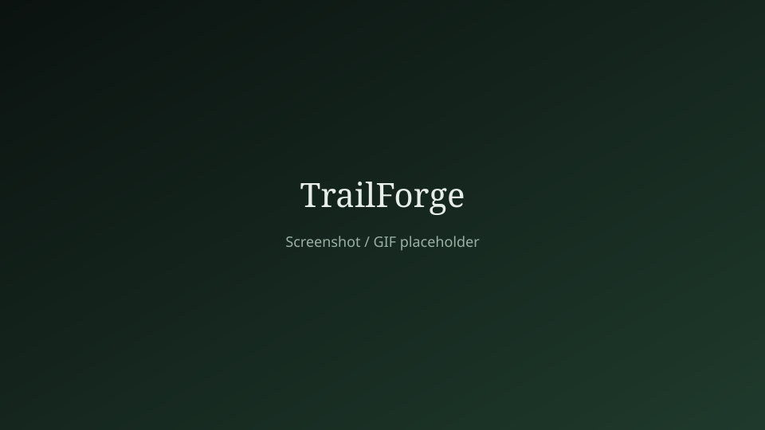

# TrailForge

TrailForgeは「エリア + テーマ + 所要時間」から、OpenStreetMap上の実在スポットだけを使った散策ルートを作ります。夕景の3Dプレビューと、OSMタグに根拠づけられた日英の説明文を生成し、検証後にGeoJSON/CSVへ書き出せます。



## セットアップ

```bash
npm ci
cp apps/api/.env.example apps/api/.env
npm run dev
```

http://localhost:5173 を開きます（`/api` は Vite 経由で API にプロキシされます）。

## アーキテクチャ

詳細は [docs/ARCHITECTURE.md](docs/ARCHITECTURE.md)。LLMキーはブラウザに出しません。ルート順はLLMではなくコードで決定し、説明文はグラウンディング検証を通過したものだけが残ります。

## ライセンス

地図データ © OpenStreetMap contributors（ODbL）。アプリ本体は MIT。`NOTICE` を参照。

## 制限

一部クラウドIPでは Nominatim が 403 になることがあります。その場合はデモ中心点とフィクスチャにフォールバックします。本番品質の文章には Claude/Ollama の設定が必要です。
