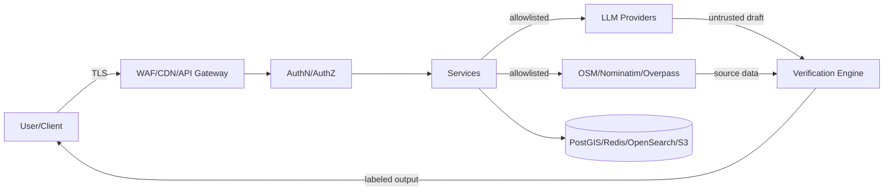

# TrailForge — Security Architecture

## 1. Security Goals

- Protect tenant/user data and API credentials.
- Preserve trust: unverifiable or fabricated claims must never be presented as verified.
- Provide enterprise-grade auditability and compliance (GDPR, SOC 2 readiness).

## 2. Trust Boundaries

## 3. Identity & Access

- **User auth:** OIDC/OAuth2; short-lived JWT access tokens; rotating refresh tokens; HttpOnly/Secure/SameSite cookies.
- **B2B auth:** API keys hashed (Argon2id), scoped, tenant-bound, expirable, revocable.
- **Enterprise:** SAML/OIDC SSO, SCIM provisioning (roadmap).
- **RBAC/ABAC:** roles (`user`, `admin`, `org_admin`, `analyst`, `developer`) + object/tenant checks. Deny by default.
- **Service-to-service:** mTLS or signed service JWTs; least-privilege IAM roles.

## 4. Data Protection

- TLS 1.2+ in transit; KMS encryption at rest for RDS/S3/Redis/OpenSearch/backups.
- Secrets in AWS Secrets Manager/SSM; never in git/client.
- PII classification, minimization, retention, deletion/anonymization.
- Audit logs append-only; sensitive fields redacted.

## 5. Application Security

- Input validation at boundaries (Zod/class-validator/OpenAPI).
- Parameterized queries/ORM; no SQL string interpolation.
- Output encoding; CSP headers for web.
- SSRF protection: outbound allowlists for source/LLM endpoints, no user-controlled internal fetches.
- Rate limiting: IP/user/API key/tenant; stricter on generate/verify/export.
- Idempotency keys for mutating endpoints.

## 6. AI / Prompt Injection / Hallucination Controls

- External/user/OSM content treated as untrusted data, never instructions.
- Prompts delimit source data; system prompt forbids fact invention.
- LLM outputs are drafts; verification engine gates user-facing factual claims.
- Statuses: `VERIFIED`, `PARTIALLY_VERIFIED`, `NEEDS_REVIEW`. Unknown facts never promoted.
- Model/provider logs redacted; configurable retention; enterprise no-train options.
- Kill switch for verification degradation or hallucination escape incidents.

## 7. Infrastructure Security

- WAF + Shield; private subnets for DB/services; public ALB only.
- Security groups/NACLs least privilege.
- Container hardening: minimal images, non-root, read-only FS, vulnerability scanning.
- IaC scanning, dependency scanning, secret scanning, SAST in CI.

## 8. Compliance

- **GDPR:** lawful basis, DPA/subprocessors, DSAR export/delete, retention policies, breach notification process.
- **SOC 2 readiness:** access reviews, change management, logging, incident response, vendor risk.
- **OWASP Top 10:** mapped controls and tests in SDLC.

## 9. Incident Response

- SEV1-SEV4 with on-call paging.
- Trust SEV1: hallucinated/unverified location presented as verified -> kill switch, audit, user notification, postmortem.
- Playbooks: credential leak, data breach, DDoS, provider outage, verification failure spike.
- Postmortem within 5 business days for SEV1/SEV2.