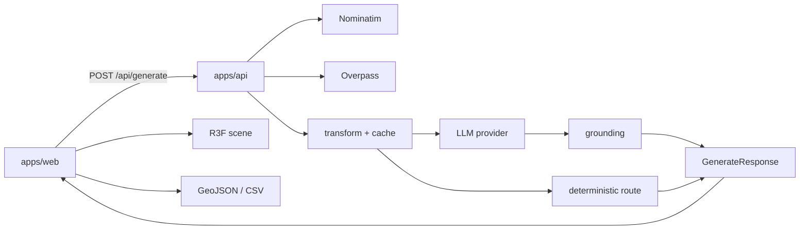

# TrailForge architecture

## Data flow

1. Browser never holds LLM keys; Vite proxies `/api` to the API.
2. API geocodes, fetches OSM (POIs/buildings/highways), projects to local meters.
3. LLM drafts bilingual claims from a delimited OSM JSON data block.
4. Grounding validator drops/flags uncited claims and hallucinated places.
5. Route order is computed in code (nearest-neighbor + 2-opt), not by the LLM.
6. Web renders a merged 3D scene, supports review, and exports approved facts.

## Why route ordering is deterministic

LLMs are bad at geometry and invent shortcuts. Straight-line distances × 1.3 detour with an 80 m/min walk budget produce repeatable, testable tours that fit `durationMinutes`.

## Why grounding exists

OSM tags are untrusted data (prompt-injection surface). Every claim must cite existing `poiId` + tag keys; numbers/URLs in prose must appear in cited values. Invented POIs are rejected.

## Threat model (short)

| Threat                        | Mitigation                                                                                         |
| ----------------------------- | -------------------------------------------------------------------------------------------------- |
| Prompt injection via OSM tags | Delimited data block; tags truncated; grounding ignores instruction-like text unless cited as data |
| API abuse                     | Helmet, JSON body limit, per-IP generate rate limit (10/min), request timeout                      |
| Upstream failures             | Timeouts, Overpass retry/fallback, typed 404/502 errors, disk cache                                |
| Secret leakage                | Server-only env for LLM keys; structured logs without keys/stacks to clients                       |
