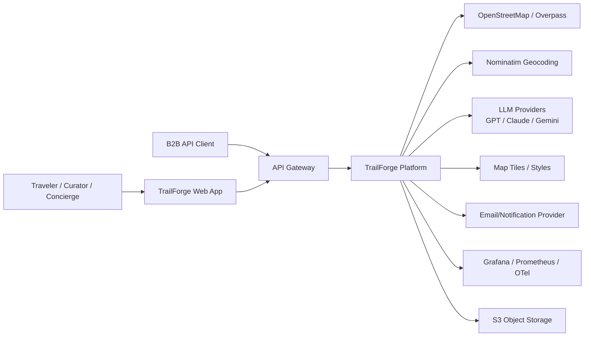
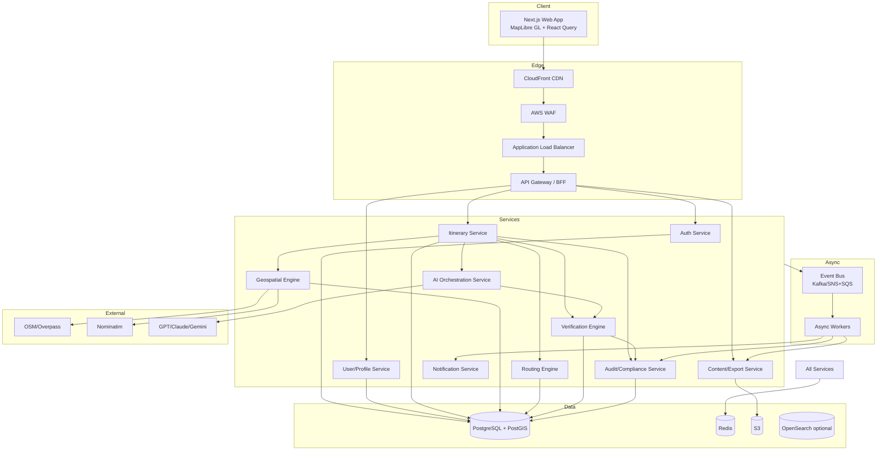
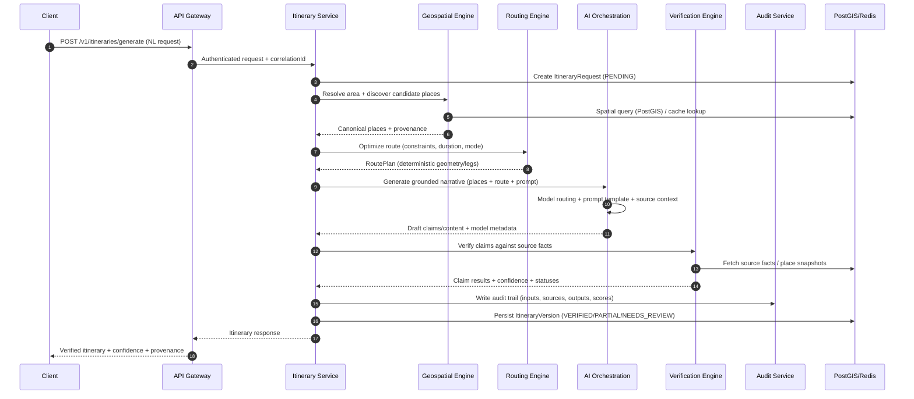
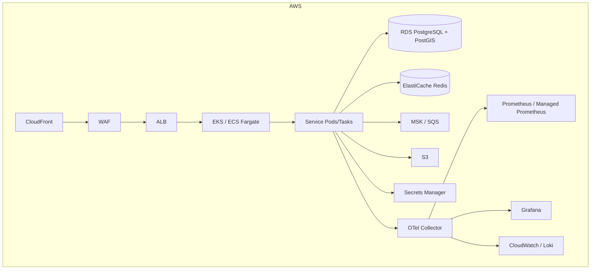

# TrailForge — System Architecture

## 1. Architecture Overview

TrailForge is a production SaaS platform built as a **domain-driven, event-driven microservice system** with a **deterministic geospatial core** and a **source-grounded AI orchestration layer**.

### Architectural Principles

1. **Ground truth is geographic data, not LLM output.** PostGIS + curated source records are authoritative.
2. **Deterministic before generative.** Spatial computation, routing, filtering, and scoring are algorithmic; LLMs handle narration, extraction assistance, and translation.
3. **Verify before publish.** No user-facing itinerary claim is emitted without verification status and provenance.
4. **Explicit bounded contexts.** Each domain owns its data, rules, and API contracts.
5. **Observable by default.** Every request carries correlation IDs; every pipeline stage emits traces, metrics, and structured logs.
6. **Secure by default.** Zero-trust service-to-service auth, least privilege, encrypted secrets, auditable actions.

## 2. System Context (C4 Level 1)

## 3. Container / Service Architecture (C4 Level 2)

## 4. Bounded Contexts (DDD)

| Bounded Context | Responsibility | Owns Data | Key Entities |
|---|---|---|---|
| **Identity & Access** | AuthN/AuthZ, sessions, API keys, roles | users, roles, sessions, api_keys | User, Role, ApiKey |
| **Profile & Preferences** | User preferences, travel profile, locales | profiles, preferences | Profile, PreferenceSet |
| **Itinerary Planning** | Orchestrates request-to-itinerary lifecycle | itineraries, itinerary_versions | Itinerary, ItineraryRequest, ItineraryVersion |
| **Geospatial Discovery** | POI discovery, canonicalization, spatial search | places, place_sources, place_snapshots | Place, PlaceSource, Geometry |
| **Routing** | Route optimization, travel-time estimation, constraints | route_plans, route_legs | RoutePlan, RouteLeg, Constraint |
| **AI Orchestration** | Prompting, model routing, generation, translation | generation_jobs, prompts, model_runs | GenerationJob, ModelRun, PromptTemplate |
| **Verification** | Claim extraction, fact matching, confidence scoring | claims, verifications, verification_evidence | Claim, VerificationResult, Evidence |
| **Content & Export** | Renderable content, exports, localization bundles | exports, content_blocks | ContentBlock, ExportArtifact |
| **Audit & Compliance** | Immutable audit trail, compliance events | audit_events | AuditEvent, ProvenanceRecord |
| **Billing** | Plans, quotas, usage metering | subscriptions, usage_records | Subscription, UsageRecord |

## 5. Data Flow — Itinerary Generation

## 6. Event-Driven Architecture

### Event Bus
- **Primary:** Kafka (MSK) for high-throughput domain events and replay.
- **Alternative/simpler start:** AWS SNS + SQS with DLQs; abstraction via internal event publisher interface.
- **Event schema:** CloudEvents envelope + versioned JSON Schema (Avro/Protobuf optional at scale).

### Core Domain Events

| Event | Producer | Consumers | Purpose |
|---|---|---|---|
| `itinerary.requested` | Itinerary Service | Analytics, Audit | Track demand |
| `places.discovered` | Geospatial Engine | Cache warmer, Analytics | Discovery telemetry |
| `route.computed` | Routing Engine | Itinerary, Audit | Route lifecycle |
| `content.generated` | AI Orchestration | Verification | Trigger verification |
| `claims.verified` | Verification Engine | Itinerary, Audit, Analytics | Quality gates |
| `itinerary.published` | Itinerary Service | Export, Notification, Search index | Downstream actions |
| `verification.failed` | Verification Engine | Audit, Alerting | Trust/SLO alert |
| `usage.recorded` | API Gateway/Billing | Billing, Quotas | Metering |

### Delivery Semantics
- At-least-once delivery; consumers idempotent via `event_id` dedupe table/cache.
- Outbox pattern for DB + event atomicity.
- DLQ per consumer with replay tooling and alerting.

## 7. API Architecture

- **External:** REST + JSON (OpenAPI 3.1) for public/B2B APIs; WebSocket/SSE for generation progress.
- **Internal:** gRPC for low-latency service-to-service calls (route/geo/verify) where beneficial; REST otherwise. Start REST+JSON for simplicity, add gRPC on hot paths.
- **BFF / API Gateway:** Next.js server actions/route handlers for web-specific composition; AWS API Gateway/WAF for public API edge.
- **Versioning:** URI versioning (`/v1`) + additive evolution; breaking changes require new major.
- **Idempotency:** `Idempotency-Key` header on POST generate/export endpoints.

## 8. Deployment Architecture (AWS)

### Environments
- `dev` — ephemeral feature testing, mocked/limited external calls.
- `staging` — production-like, anonymized data, full CI/CD gates.
- `prod` — multi-AZ, autoscaling, blue/green deployments, strict alerting.

## 9. Key Design Decisions

| Decision | Choice | Rationale | Tradeoff |
|---|---|---|---|
| Spatial DB | PostgreSQL + PostGIS | Mature spatial indexes, SQL, transactions, geospatial functions | Vertical limits mitigated by read replicas + partitioning |
| Backend framework | NestJS | Modular DI, TS-first, OpenAPI, microservice support | Heavier than Express; worth it for large team/DDD |
| Frontend | Next.js App Router | SSR/SEO, server actions, strong ecosystem | App Router complexity; mitigated by conventions |
| Map rendering | MapLibre GL | Open, performant vector maps, no vendor lock-in | Requires tile/style hosting decisions |
| Event bus | Kafka/MSK (abstracted) | Replay, throughput, consumer groups | Operational complexity; SNS/SQS for early stage |
| AI providers | Multi-provider abstraction | Avoid lock-in, route by task/cost/quality | More integration/testing surface |
| Verification | Deterministic rules + semantic matcher | High precision on factual claims | Recall/edge cases require continuous tuning |

## 10. Cross-Cutting Concerns

- **Observability:** OpenTelemetry traces/metrics/logs; correlation IDs propagated end-to-end.
- **Security:** OIDC/JWT auth, RBAC/ABAC, mTLS/service mesh optional, secrets in AWS Secrets Manager.
- **Resilience:** Circuit breakers, retries with jitter, timeouts, bulkheads, DLQs.
- **Data governance:** PII classification, encryption at rest/in transit, retention policies, GDPR DSAR flows.
- **Performance:** Redis caching, PostGIS spatial indexes, CDN, async generation with progress updates.
